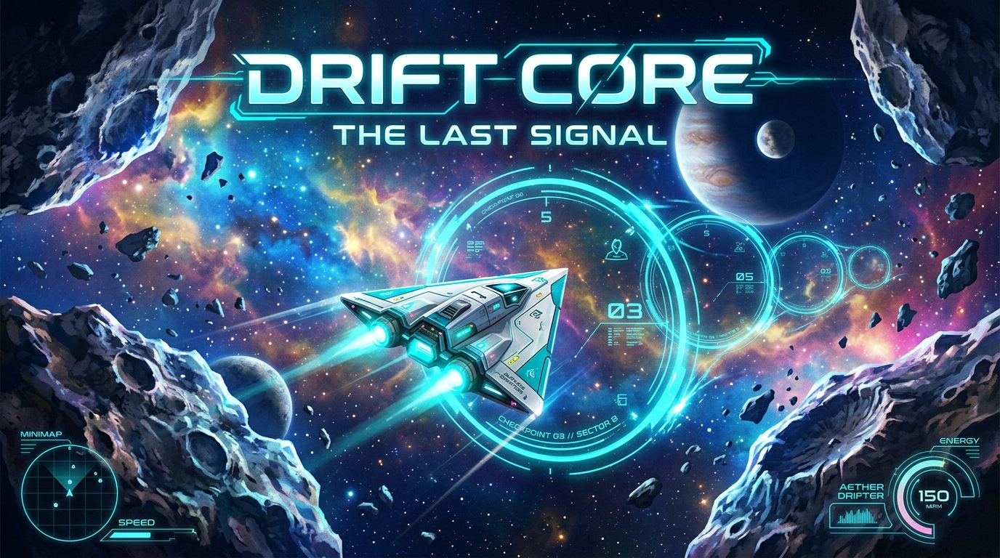
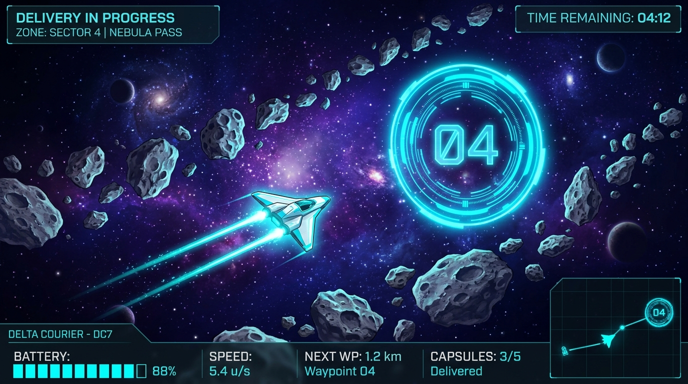
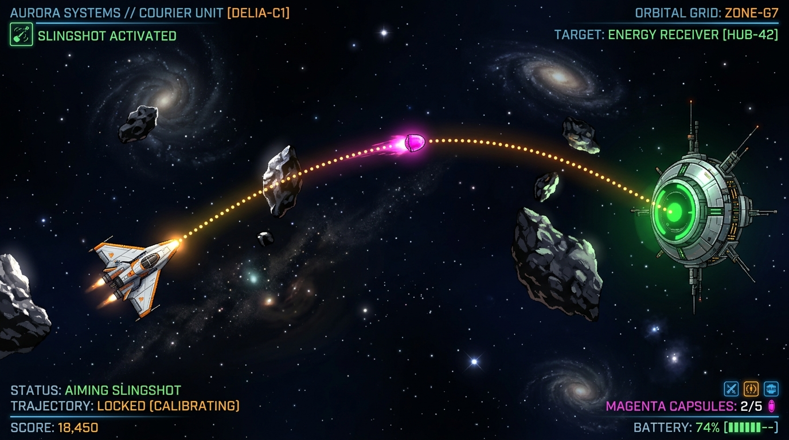
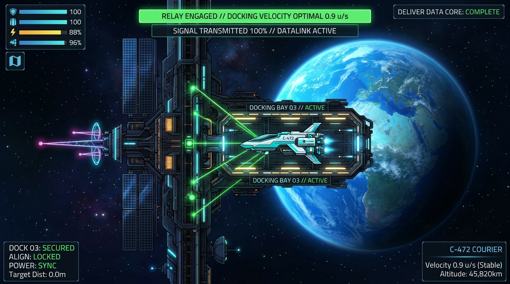
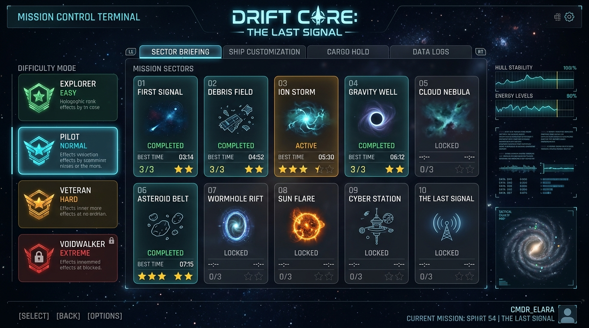
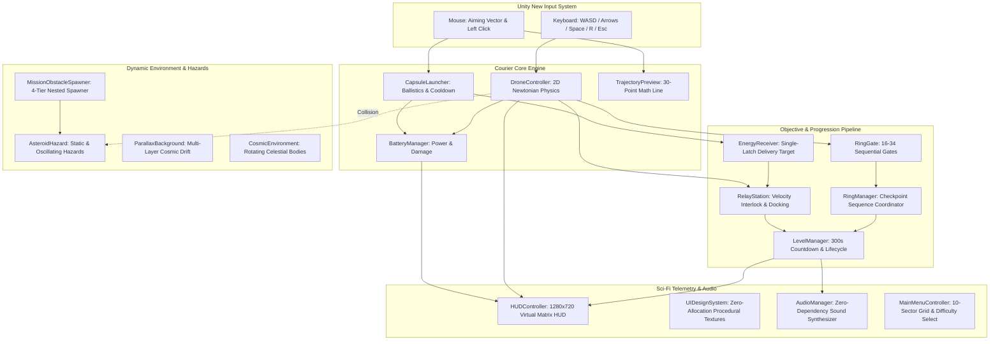

# ✦ DRIFT CORE: The Last Signal ✦

<div align="center">



<br/><br/>

[](https://unity.com/)
[-792EE5.svg?style=for-the-badge&logo=render&logoColor=white)](https://unity.com/features/user-interface)
[](https://learn.microsoft.com/en-us/dotnet/csharp/)
[](https://www.microsoft.com/windows)
[](https://docs.unity3d.com/Packages/com.unity.inputsystem@latest)
[](#-automated-verification-suite)
[](#-campaign-sectors)
[](#-difficulty-modes)
[](https://google.github.io/styleguide/csharp-style.html)
[](LICENSE)

<br/>

**A precision zero-gravity 2D sci-fi courier simulator engineered for Unity 6 LTS.**  
*Pilot through 10 expansive cosmic corridors, thread sequential checkpoint gates, weave through mid-route dynamic asteroid hazard fields, sling high-energy plasma capsules into receiver arrays, and execute precision soft-docking maneuvers at orbital relay spires across 4 flight difficulty modes.*

<br/>

[🚀 Quick Start](#-quick-start--installation) •
[📸 Gameplay Showcase](#-gameplay-showcase) •
[🎮 Flight Controls](#-flight-controls--pilot-manual) •
[🌌 Core Mechanics](#-core-gameplay-mechanics) •
[🗺️ Campaign Sectors](#-campaign-sectors) •
[⚙️ Difficulty Modes](#-difficulty-modes) •
[📐 Mathematical Models](#-physics--mathematical-foundations) •
[🏗️ Architecture](#-system-architecture) •
[🧪 Verification Suite](#-automated-verification-suite)

---

</div>

<br/>

## 📖 Mission Briefing

The outer galactic relay network has collapsed, severing interstellar communication across remote sectors. As the pilot of the high-mobility **Delta Courier Drone**, your directive is to traverse forgotten corridors of deep space, activate sequential holographic checkpoint gates, sling high-energy plasma capsules into receiver arrays, and execute precision soft-docking at each sector's **Relay Station Spire** before battery reserves fail.

In the vacuum of space, **Newtonian inertia rules supreme**: every burst of thruster fire continues indefinitely until counteracted by retro-burns. You must calculate drift, respect momentum, avoid kinetic impacts with rogue asteroid belts, and guide the Last Signal back to life.

---

## 📸 Gameplay Showcase

<div align="center">

### Flight Navigation & Hazard Fields


*Pilot through undulating deep-space corridors, thread sequential holographic ring gates, and dodge static and moving asteroid hazard belts under strict battery conservation.*

<br/>

### Precision Ballistic Plasma Slingshot


*Aim with the mouse to project a real-time Newtonian trajectory line, launching zero-g plasma energy capsules through asteroid gaps into receiver dishes.*

<br/>

### Orbital Relay Station Soft-Docking


*Execute precision retro-burns to decelerate below safe velocity limits ($\le 1.5\text{ u/s}$) within the docking bay to synchronize communications and restore the sector.*

<br/>

### Mission Control Terminal & Difficulty Selection


*Select from 10 extended campaign sectors across 4 calibrated difficulty modes (Explorer, Pilot, Veteran, Voidwalker) with persistent mission progression.*

</div>

---

## 🎮 Flight Controls & Pilot Manual

The courier drone is controlled via keyboard thrust and mouse trajectory targeting using the **Unity New Input System**:

| Control | Key / Input | Action & Maneuver Notes |
| :--- | :---: | :--- |
| **Main Thruster** | <kbd>W</kbd> / <kbd>↑</kbd> | Fires main engine forward; generates continuous linear momentum |
| **Retro / Reverse** | <kbd>S</kbd> / <kbd>↓</kbd> | Fires retro-thrusters to counter velocity or reverse heading |
| **Port / Starboard Drift** | <kbd>A</kbd> / <kbd>D</kbd> or <kbd>←</kbd> / <kbd>→</kbd> | Applies lateral maneuvering impulses for slalom navigation |
| **Aiming System** | <kbd>Mouse Cursor</kbd> | Projects real-time calculated ballistic trajectory line |
| **Launch Capsule** | <kbd>Space</kbd> / <kbd>Left Click</kbd> | Fires a zero-g plasma energy core along the predicted flight path |
| **Emergency Reboot** | <kbd>R</kbd> | Instantly restarts current sector after collision or battery drain |
| **Sector Advance** | <kbd>Space</kbd> / <kbd>Enter</kbd> | Transitions to subsequent mission sector upon relay activation |
| **Pause / Tactical HUD** | <kbd>Escape</kbd> / <kbd>P</kbd> | Toggles mission pause menu and tactical overview |
| **Window Toggle** | <kbd>F11</kbd> / <kbd>Alt+Enter</kbd> | Toggles between borderless fullscreen and 90% clamped window |

> [!TIP]
> **The Retro-Braking Doctrine**: Because there is minimal drag in deep space ($c_d = 0.2\text{ s}^{-1}$), your courier drone coasts on accumulated inertia. To slow down for relay docking, tap your thruster in the exact opposite direction of your flight vector or watch the real-time speedometer in the HUD.

---

## 🌌 Core Gameplay Mechanics

### 1. Calibrated World Scaling & Zero-Override Architecture
All entities in Drift Core are calibrated to exact on-screen world dimensions in their source prefabs:
* **Player Drone**: `~1.20u` length (hull diameter ~1.06u, local scale 0.132)
* **Ring Gate**: `~2.40u` outer diameter (comfortable passage clearance for the drone, local scale 0.26)
* **Relay Station Spire**: `~3.20u` height (activation zone radius 2.2u, local scale 0.335)
* **Gameplay Asteroids**: `1.0–1.8u` diameter (base prefab 1.39u at scale 0.17, varied via runtime `scaleMultiplier` 0.8–1.3)
* **Energy Capsule**: `~0.40u` diameter (local scale 0.057)
* **Energy Receiver**: `~1.50u` diameter (local scale 1.43)
* **Orthographic Camera**: Size `7.5` across all level scenes (`8.0` in Main Menu), guaranteeing full visibility of corridors without void edges.
* **Zero Scale Overrides Policy**: No `m_LocalScale` overrides in any `.unity` scene file (verified by automated test).

### 2. Zero-G Inertial Flight Dynamics
Governed by [DroneController](Assets/_NebulaRelay/Scripts/Player/DroneController.cs) using a pure 2D Newtonian physics simulation:
* **Thrust Rating**: `6.0 u/s²` with smooth directional interpolation towards movement vector.
* **Top Speed Cap**: Strictly capped at `8.0 u/s` to maintain navigational precision.
* **Inertial Coasting**: Subtle drag coefficient ($c_d = 0.2\text{ s}^{-1}$) delivers the authentic feel of deep-space drift while retaining crisp micro-adjustments.
* **Flight Corridor Soft-Clamping**: The drone is soft-clamped inside the level corridor ($X \in [\text{MinX}, \text{MaxX}]$, $Y \in [-6.5, +6.5]$). When contacting boundary limits, outward velocity is cleanly zeroed and a warning alert is flashed on the HUD.
* **Dynamic Visuals**: Animated thruster trail, rotation smoothing, and kinetic hull feedback handled by [DroneVisuals](Assets/_NebulaRelay/Scripts/Player/DroneVisuals.cs).

### 3. Ballistic Trajectory & Energy Capsule Launcher
Implemented across [CapsuleLauncher](Assets/_NebulaRelay/Scripts/Delivery/CapsuleLauncher.cs), [EnergyCapsule](Assets/_NebulaRelay/Scripts/Delivery/EnergyCapsule.cs), and [TrajectoryPreview](Assets/_NebulaRelay/Scripts/Delivery/TrajectoryPreview.cs):
* **Predictive LineRenderer**: Casts 30 analytical Newtonian sample points showing the exact path the capsule will travel before firing.
* **Single-Slot Protocol**: Only one simultaneous capsule may exist in flight at a time (`0.5s` cooldown), requiring deliberate targeting.
* **Zero-G Projectile Mechanics**: Projectiles travel at `12.0 u/s` with true zero-gravity ballistics and automatic boundary despawning outside flight limits.

### 4. Sequential Holographic Checkpoint Gates
Managed by [RingManager](Assets/_NebulaRelay/Scripts/World/RingManager.cs) and [RingGate](Assets/_NebulaRelay/Scripts/World/RingGate.cs):
* **Strict Sequential Logic**: Checkpoints must be threaded in order (`Gate 1 → Gate 2 → Gate 3...`).
* **Passage Clearance**: Calibrated gate openings allow the drone to glide through comfortably.
* **Audio-Visual Feedback**:
  * *Active Gate*: Pulsing cyan hologram waiting for passage.
  * *Cleared Gate*: Transitions to neon emerald with harmonic validation tone.
  * *Wrong-Order Penalty*: Flashes warning crimson with rejection tone; progression is blocked until previous gates are cleared.

### 5. Mid-Route Obstacles & Moving Hazards
Orchestrated by [MissionObstacleSpawner](Assets/_NebulaRelay/Scripts/World/MissionObstacleSpawner.cs) and [AsteroidHazard](Assets/_NebulaRelay/Scripts/World/AsteroidHazard.cs):
* **Pre-Baked Scene Hierarchy Tiers**: All mission scenes contain 4 pre-baked obstacle tier containers:
  * `Obstacles_Tier1_Easy` (Explorer mode)
  * `Obstacles_Tier2_Normal` (Pilot / Normal mode)
  * `Obstacles_Tier3_Hard` (Veteran mode)
  * `Obstacles_Tier4_Expert` (Voidwalker mode)
* **Nested Subset Rule**: Higher difficulties are strict supersets ($\text{Easy} \subset \text{Normal} \subset \text{Hard} \subset \text{Expert}$), ensuring players build mastery on familiar route foundations.
* **Moving Hazards**: 28% to 60% of hazards across all missions dynamically oscillate vertically or patrol horizontally, scaled by the difficulty speed multiplier ($0.7\times$ to $1.5\times$).
* **Dual Flank Placement**: Obstacles alternate between upper flanks ($Y \in [+1.5, +5.0]$) and lower flanks ($Y \in [-5.0, -1.5]$), forcing active maneuvering and slalom lines rather than straight-line coasting.

### 6. Dual-Phase Relay Station Activation
Orchestrated by [RelayStation](Assets/_NebulaRelay/Scripts/World/RelayStation.cs), [RelayStationVisuals](Assets/_NebulaRelay/Scripts/World/RelayStationVisuals.cs), and [EnergyReceiver](Assets/_NebulaRelay/Scripts/World/EnergyReceiver.cs):
* **Phase 1: Energy Delivery**: Sling the plasma capsule into the stationary receiver dish. The receiver latches once, transitions to energized green, and primes the relay tower.
* **Phase 2: Safe-Speed Docking**: Navigate the drone into the relay docking zone. 
* **Safe Velocity Interlock**: Docking speed must not exceed **$1.5\text{ u/s}$** (on Normal).
  * If velocity exceeds $1.5\text{ u/s}$, the docking system repels the drone with an audible alert and an on-screen **"SLOW DOWN!"** indicator.
  * Approaching at safe speed activates the relay tower, ignites the master beacon beam, and completes the sector.

### 7. Power & Shield Management
Handled by [BatteryManager](Assets/_NebulaRelay/Scripts/Core/BatteryManager.cs):
* **Max Capacity**: 100% capacity displayed via dynamic HUD gauge.
* **Thruster Consumption**: Depletes at `0.36% / sec` under continuous propulsion.
* **Launch Cost**: Expends `4.0%` energy per capsule fire.
* **Kinetic Damage**: Colliding with [AsteroidHazard](Assets/_NebulaRelay/Scripts/World/AsteroidHazard.cs) obstacles deals `-15%` immediate shield loss with physical recoil.
* **Critical Warning & Depletion**: Flashes red alert below `20%`; total depletion (`0%`) disables ship systems and triggers mission failure.

### 8. Procedural Audio Synthesizer
Powered by [AudioManager](Assets/_NebulaRelay/Scripts/Effects/AudioManager.cs):
* **Zero External Dependencies**: Generates pure procedural audio waveforms directly into memory using math routines.
* **Dynamic Waveforms**:
  * *Thruster Propulsion*: Modulated low-frequency noise rumble.
  * *Capsule Fire*: High-pitch frequency-swept laser chirp.
  * *Gate Checkpoint*: Harmonic resonant bell chime.
  * *Docking Success*: Victorious multi-tone arpeggiated fanfare.
  * *Speed & Boundary Warnings*: Rapid square-wave warning buzzers.
  * *Ambient Space*: Continuous generative cosmic hum.

---

## 🗺️ Campaign Sectors

The campaign spans 10 progressively demanding sectors, selectable from the [MainMenuController](Assets/_NebulaRelay/Scripts/UI/MainMenuController.cs) Mission Briefing terminal:

| Sector | Codename | Checkpoints | Path Length | Estimated Par | Base Timer | Hazard Profile | Tactical Challenge |
| :---: | :--- | :---: | :---: | :---: | :---: | :--- | :--- |
| **01** | **First Signal** | 16 Gates | 328u | 120s | 300s (5:00) | Calm orbital drift corridor | Zero-g propulsion basics, launch first capsule, safe dock |
| **02** | **The Debris Field** | 18 Gates | 365u | 130s | 300s (5:00) | Dense asteroid gauntlet | Thread tight lanes, preserve battery from kinetic impacts |
| **03** | **The Ion Storm** | 20 Gates | 400u | 140s | 300s (5:00) | Dynamic hazard slaloms (35% moving) | Oscillating asteroid gates, cross-drift navigation |
| **04** | **The Gravity Well** | 22 Gates | 438u | 155s | 300s (5:00) | Perimeter debris & narrow gates | Precision speed management, high-risk retro-burns |
| **05** | **The Omega Transmission** | 24 Gates | 474u | 170s | 300s (5:00) | Multi-tier hazard gauntlet (42% moving) | Complex chicane threading, 24 sequential checkpoints |
| **06** | **The Silent Array** | 26 Gates | 510u | 180s | 300s (5:00) | Dormant sensor grid debris | Extended endurance corridor, continuous slalom gates |
| **07** | **The Pulsar Reach** | 28 Gates | 547u | 195s | 300s (5:00) | High-frequency radiation hazard zones | Tightening corridor clearance, high-speed retro-braking |
| **08** | **The Shattered Moon** | 30 Gates | 583u | 205s | 300s (5:00) | Lunar fragment gauntlet (50% moving) | Drifting lunar clusters, rapid directional transitions |
| **09** | **The Event Horizon** | 32 Gates | 620u | 215s | 300s (5:00) | Ergosphere gravitational anomalies | Extreme drift velocity management across 32 gates |
| **10** | **The Last Signal** | 34 Gates | 655u | 230s | 300s (5:00) | Galactic nexus core gauntlet (60% moving) | Campaign finale: 34 gates, restore all galactic relays |

---

## ⚙️ Difficulty Modes

Drift Core features 4 calibrated difficulty modes extending gameplay without altering core physics:

| Difficulty Mode | Rank Badge | Timer (Base) | Docking Speed Limit | Hazard Speed | Polyline Clearance | Capsules | Score Multiplier |
| :--- | :---: | :---: | :---: | :---: | :---: | :---: | :---: |
| **Explorer** | `EXPLORER` (Green) | **360s (6:00)** | $\le 1.8\text{ u/s}$ | $0.7\times$ | $\ge 3.2\text{u}$ | 4 Ready | $1.0\times$ |
| **Pilot (Normal)**| `PILOT` (Cyan) | **300s (5:00)** | $\le 1.5\text{ u/s}$ | $1.0\times$ | $\ge 2.6\text{u}$ | 2 Ready | $1.0\times$ |
| **Veteran** | `VETERAN` (Amber) | **270s (4:30)** | $\le 1.2\text{ u/s}$ | $1.3\times$ | $\ge 2.2\text{u}$ | 2 Ready | $1.5\times$ |
| **Voidwalker** | `VOIDWALKER` (Red) | **240s (4:00)** | $\le 1.0\text{ u/s}$ | $1.5\times$ | $\ge 1.9\text{u}$ | 2 Ready | $2.0\times$ |

---

## 📐 Physics & Mathematical Foundations

### 1. Newtonian Ballistic Trajectory
The trajectory preview and capsule ballistics share identical Newtonian mechanics modeled in [TrajectoryPreview](Assets/_NebulaRelay/Scripts/Delivery/TrajectoryPreview.cs):

$$p(t) = p_0 + v_0 t + \frac{1}{2} a t^2$$

In zero-gravity deep space where gravitational acceleration $a = 0$:

$$p(t) = p_0 + v_0 t$$

The trajectory preview samples 30 discrete intervals across $t \in [0, 1.5\text{ s}]$, producing an exact overlay with the projectile's physical trajectory.

### 2. Inertial Damping & Speed Clamping
Linear drag and velocity clamping ensure responsive control while preserving authentic space drift:

$$v_{t + \Delta t} = \min\left(\|v_t\| \cdot (1 - c_d \Delta t), \; v_{\max}\right) \cdot \hat{v}_t$$

Where:
* $c_d = 0.2\text{ s}^{-1}$ (Linear drag coefficient)
* $v_{\max} = 8.0\text{ u/s}$ (Maximum courier velocity)
* Launch velocity $v_{\text{capsule}} = 12.0\text{ u/s}$

### 3. Safe Docking Interlock
The relay docking clamp strictly evaluates drone kinetic energy at boundary contact:

$$\|v_{\text{drone}}\| \le v_{\text{docking\_limit}} \quad (v_{\text{docking\_limit}} = 1.5\text{ u/s on Normal})$$

If $\|v_{\text{drone}}\| > v_{\text{docking\_limit}}$, docking fails and an elastic impulse repels the ship away from the spire.

### 4. Battery Expenditure Model
Battery power drains deterministically through idle life support, continuous propulsion, and capsule launches:

$$B(t) = B_0 - \int_{0}^{t} \left( r_{\text{idle}} + r_{\text{thrust}} \cdot \mathbb{I}_{\text{thrust}}(s) \right) ds - n_{\text{capsules}} \cdot C_{\text{launch}} - n_{\text{hits}} \cdot D_{\text{hazard}}$$

Where:
* $r_{\text{thrust}} = 0.36\% / \text{s}$
* $C_{\text{launch}} = 4.0\%$ per capsule fired
* $D_{\text{hazard}} = 15.0\%$ damage per asteroid collision

### 5. Harmonic Hazard Motion
Moving hazards oscillate perpendicular or parallel to the corridor:

$$y_{\text{hazard}}(t) = y_0 + A \cdot \sin(\omega t + \phi)$$

Where amplitude $A \in [1.0\text{u}, 1.8\text{u}]$ and frequency $\omega = \frac{2\pi}{T} \cdot \mu_{\text{diff}}$, clamped to remain within $|Y| \le 5.2\text{u}$.

---

## 🏗️ System Architecture



---

## 🧪 Automated Verification Suite

Drift Core includes two comprehensive automated validation suites integrated directly into the Unity Editor:

### 1. Verification Test Suite (48 / 48 Tests Passing)
Located in [NebulaRelayVerificationTests](Assets/_NebulaRelay/Editor/NebulaRelayVerificationTests.cs):
* **Core Physics & Math**: Newtonian trajectory formula, velocity clamping, safe docking bounds, battery expenditure curves.
* **Objective Sequencing**: Sequential ring gate progression, wrong-order rejection, receiver single-latch behavior.
* **World Calibrations**: Prefab scale checks (Drone ~1.2u, Ring ~2.4u, Relay ~3.2u, Asteroid 1.0-1.8u, Capsule ~0.4u, Receiver ~1.5u).
* **Zero Scale Overrides Policy (Test 44)**: Scans all `.unity` scene files to guarantee zero `m_LocalScale` overrides.
* **Camera Bounds**: Verifies camera orthographic size is exactly 7.5 across all levels and 8.0 in MainMenu.
* **UI Design System**: Tests text fitting across 5 common resolutions (1280x720, 1366x768, 1600x900, 1920x1080, 2560x1440) ensuring zero text clipping or overlapping elements.

### 2. Mission Validator (40 / 40 Combinations Validated)
Located in [MissionValidator](Assets/_NebulaRelay/Editor/MissionValidator.cs):
* **Full Matrix Coverage**: Validates all 10 missions across all 4 difficulty modes ($10 \times 4 = 40$ combinations).
* **Route Spacing**: Ensures 14u–22u distance between successive checkpoints.
* **Corridor Clamping**: Ensures all ring gates, hazards, receivers, and spires reside strictly within flight corridors ($|Y| \le 5.2\text{u}$).
* **Par & Timer Feasibility**: Verifies estimated par time $\ge 120\text{s}$, base timer $\ge 1.25\times\text{par}$, and battery depletion is safely within 100%.
* **Obstacle Clearance & Nesting**: Enforces strict minimum clearance along the flight polyline ($\ge 1.9\text{u} - 3.2\text{u}$) and verifies nested subset tiering.

### How to Run Tests in Unity Editor:
```
Top Menu Bar ──> Drift Core ──> Run All Verification Tests   (Ctrl+Alt+T)
Top Menu Bar ──> Drift Core ──> Validate All Missions         (Ctrl+Alt+V)
```

---

## 🚀 Quick Start & Installation

### Prerequisites
* **Unity 6 LTS** (`6000.0.84f1` or later)
* **Universal Render Pipeline (URP 2D)**
* **Unity New Input System** (`com.unity.inputsystem`)
* **OS**: Windows 10 / 11 x64

### 1. Clone Repository
```bash
git clone https://github.com/shreyasadiga82/NebulaRelay.git
cd NebulaRelay
```

### 2. Open in Unity Hub
1. Open **Unity Hub**.
2. Click **Add** $\rightarrow$ **Add project from disk**.
3. Select the `NebulaRelay` folder.
4. Launch the project using **Unity 6 (6000.0.84f1)**.

### 3. Run & Play
1. In the Project window, navigate to `Assets/_NebulaRelay/Scenes/`.
2. Open [MainMenu.unity](Assets/_NebulaRelay/Scenes/MainMenu.unity) or [Level_01.unity](Assets/_NebulaRelay/Scenes/Level_01.unity).
3. Click the **Play** button in the top toolbar.

### 4. Build Standalone Windows Executable
To generate a standalone `.exe`:
```
Top Menu Bar ──> Drift Core ──> Build Windows Standalone (.exe)
```
The compiled executable will be output to `Builds/DriftCore.exe`.

---

## 📁 Repository Directory Structure

```
NebulaRelay/
├── Assets/
│   └── _NebulaRelay/
│       ├── Art/                          # 1024px High-Resolution 2D Space Sprites
│       │   ├── Drone_Courier.png         # Player delta spacecraft
│       │   ├── RelayStation_Tower.png    # Orbital communications spire
│       │   ├── RingGate_Neon.png         # Holographic checkpoint ring
│       │   ├── EnergyCapsule_Core.png    # Magenta plasma projectile
│       │   ├── Asteroid_Detailed.png     # Cratered deep-space hazard
│       │   ├── Planet_BlueOcean.png      # Terrestrial backdrop planet
│       │   ├── MainMenu_CosmicBG.png     # Panoramic title vista
│       │   ├── Nebula_FirstSignal.png    # Sector 1 cyan nebula skybox
│       │   ├── Nebula_DebrisField.png    # Sector 2 magenta nebula skybox
│       │   ├── Nebula_LastTransmission.png # Sector 3 electric azure skybox
│       │   ├── Nebula_GravityWell.png    # Sector 4 golden vortex skybox
│       │   └── Nebula_OmegaCore.png      # Sector 5 deep-violet nexus skybox
│       │
│       ├── Prefabs/                      # Calibrated Game Prefabs (Zero Overrides)
│       │   ├── PlayerDrone.prefab        # Courier drone (~1.2u) with physics & weapons
│       │   ├── EnergyCapsule.prefab      # Zero-g plasma projectile (~0.4u)
│       │   ├── RingGate.prefab           # Holographic checkpoint ring (~2.4u)
│       │   ├── EnergyReceiver.prefab     # Stationary energy collection dish (~1.5u)
│       │   ├── RelayStation.prefab       # Dual-phase orbital transmission tower (~3.2u)
│       │   └── AsteroidHazard.prefab     # Kinematic/patrolling kinetic obstacle (1.0-1.8u)
│       │
│       ├── Scenes/                       # 11 Registered Game Scenes
│       │   ├── MainMenu.unity            # Scene 0: Title, difficulty selector, 10-mission grid
│       │   ├── Level_01.unity            # Scene 1: Sector 01 - First Signal (16 Gates)
│       │   ├── Level_02.unity            # Scene 2: Sector 02 - The Debris Field (18 Gates)
│       │   ├── Level_03.unity            # Scene 3: Sector 03 - The Ion Storm (20 Gates)
│       │   ├── Level_04.unity            # Scene 4: Sector 04 - The Gravity Well (22 Gates)
│       │   ├── Level_05.unity            # Scene 5: Sector 05 - The Omega Transmission (24 Gates)
│       │   ├── Level_06.unity            # Scene 6: Sector 06 - The Silent Array (26 Gates)
│       │   ├── Level_07.unity            # Scene 7: Sector 07 - The Pulsar Reach (28 Gates)
│       │   ├── Level_08.unity            # Scene 8: Sector 08 - The Shattered Moon (30 Gates)
│       │   ├── Level_09.unity            # Scene 9: Sector 09 - The Event Horizon (32 Gates)
│       │   └── Level_10.unity            # Scene 10: Sector 10 - The Last Signal (34 Gates, Finale)
│       │
│       ├── Scripts/
│       │   ├── Core/                     # GameManager, LevelManager, BatteryManager, SettingsManager
│       │   ├── Player/                   # DroneController, DroneVisuals
│       │   ├── Delivery/                 # CapsuleLauncher, EnergyCapsule, TrajectoryPreview
│       │   ├── World/                    # RingGate, RingManager, RelayStation, AsteroidHazard, MissionData, MissionObstacleSpawner
│       │   ├── UI/                       # HUDController, MainMenuController, UIScale, UIDesignSystem
│       │   └── Effects/                  # AudioManager (zero-dependency sound synthesizer)
│       │
│       └── Editor/                       # NebulaSceneBuilder, NebulaRelayVerificationTests, MissionValidator
├── docs/
│   └── images/                           # Showcase screenshots & hero banners
├── DEVELOPMENT_STATUS.md                 # Granular phase tracking & architecture status
└── README.md                             # Primary repository documentation
```

---

## ⚡ Technical Specifications

* **Target Framerate**: 60–144 FPS V-Sync
* **Physics Refresh**: `FixedUpdate` running at 50Hz ($0.02\text{s}$)
* **Physics Gravity**: `(0, 0)` zero gravity
* **Coordinate System**: Pure 2D Cartesian ($X$ horizontal corridor, $Y$ vertical flight bounds)
* **Audio Engine**: Mathematical procedural synthesizers; zero uncompressed audio disk bloat
* **Camera System**: Orthographic size 7.5 across all 10 levels (8.0 in MainMenu) with velocity-based lookahead damping
* **UI Design System**: 1280x720 virtual reference matrix, zero GC allocations in hot loops, procedural textures
* **Asset Optimization**: High-resolution 1024px sprite textures with Full Rect mesh type, mipmaps disabled, and standard compression

---

## 📜 Credits & License

* **Lead Developer**: Shreyas Adiga ([@shreyasadiga82](https://github.com/shreyasadiga82))
* TEAM: SIDHARTH R , SREELAKSHMI RAJESH
* **Engine**: Built with [Unity 6 LTS](https://unity.com/)
* **License**: Released under the [MIT License](LICENSE). Open for educational, personal, and commercial development.

<div align="center">
  <br/>
  <sub>✦ Crafted with precision for high-speed cosmic couriers across the galaxy ✦</sub>
</div>
